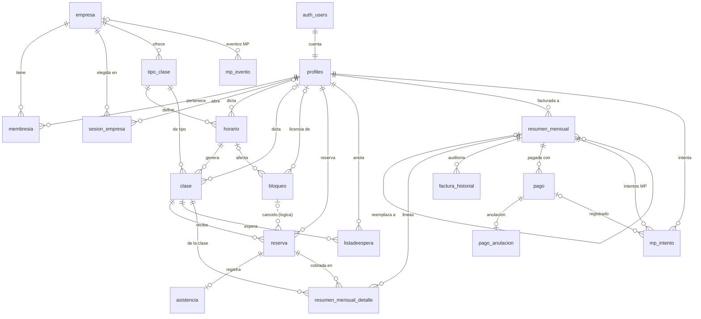
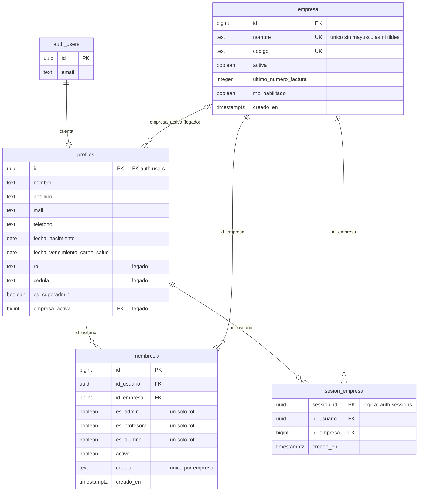
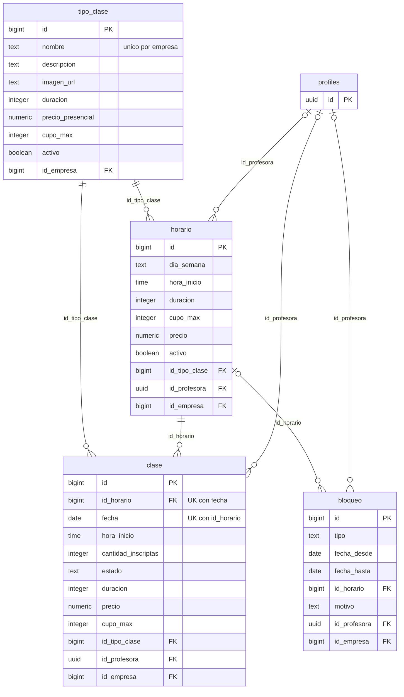
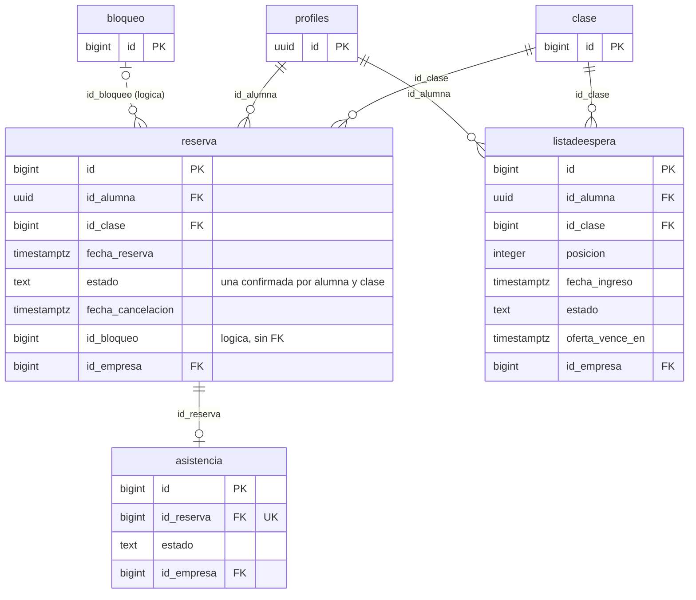
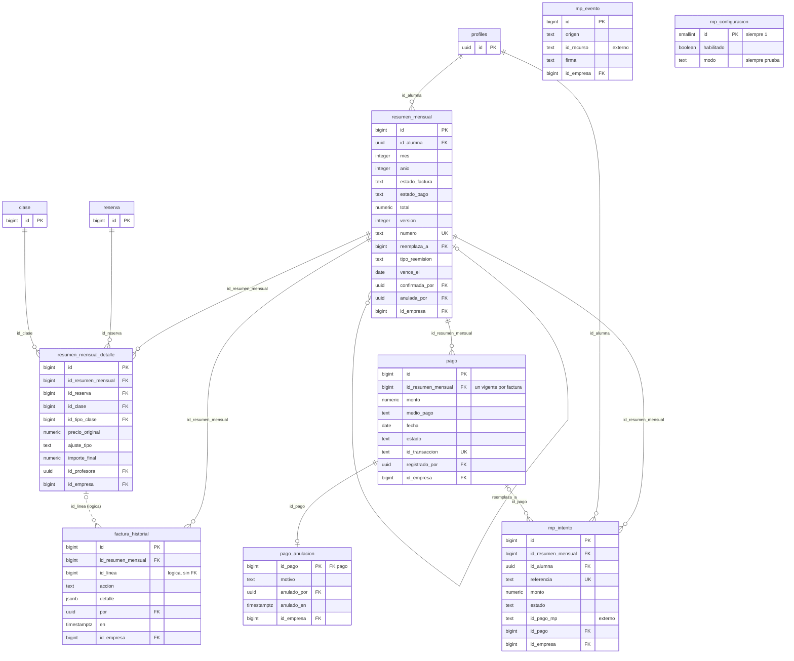

# Just Show Up — Modelo entidad-relación (MER)

**Fuente:** esquema real de Supabase de producción (proyecto `nspgafucytcjqkqnmkry`), leído el **02/11/2026** solo con
consultas de lectura sobre el catálogo de Postgres, con las **23 migraciones aplicadas** (la última: `tres_roles`).
Todo lo de este documento sale de la base: tablas, columnas, claves primarias (PK), claves foráneas (FK),
restricciones `UNIQUE`/`CHECK`/`NOT NULL`, índices únicos y triggers.

**Convenciones**
- **FK real**: restricción `FOREIGN KEY` en la base. **Relación lógica**: el vínculo existe, pero lo controla la
  aplicación o una función SQL, no una FK. En los diagramas: **línea continua = FK real**, **línea punteada = lógica**.
- Todas las tablas del negocio tienen `id_empresa → empresa.id` (FK real, obligatoria). Para no repetirlo en cada
  diagrama por módulo, se muestra en el diagrama general y en la sección «Empresas».
- `auth.users` es la tabla de cuentas de Supabase Auth (esquema `auth`, no `public`): guarda mail y contraseña.

---

## 1. Módulos

| Módulo | Tablas |
|---|---|
| Empresas y personas | `empresa`, `profiles` (+ `auth.users`), `membresia`, `sesion_empresa` |
| Clases | `tipo_clase`, `horario`, `clase`, `bloqueo` |
| Reservas y asistencia | `reserva`, `listadeespera`, `asistencia` |
| Facturación y pagos | `resumen_mensual`, `resumen_mensual_detalle`, `factura_historial`, `pago`, `pago_anulacion` |
| Mercado Pago (modo de prueba) | `mp_configuracion`, `mp_intento`, `mp_evento` |
| Técnica (no es del negocio) | `_tres_roles_respaldo` |

---

## 2. Inventario de tablas

Columnas: **Null** = admite nulo (`NO` = `NOT NULL`). Los `id` `bigint` son `identity` (autonuméricos).

### Empresas y personas

#### `empresa` — cada lugar que usa la plataforma (multiempresa)
| Columna | Tipo | Null | Detalle |
|---|---|---|---|
| id | bigint | NO | **PK** (identity) |
| nombre | text | NO | 2–80 caracteres; **único** sin contar mayúsculas, tildes ni signos (índice `empresa_nombre_lugar_unico`): es lo que se escribe al iniciar sesión |
| codigo | text | NO | **UNIQUE**; 2–6 letras mayúsculas; prefijo del número de factura |
| activa | boolean | NO | por defecto `true` |
| ultimo_numero_factura | integer | NO | contador propio de facturas (≥ 0) |
| mp_habilitado | boolean | NO | Mercado Pago (de prueba) habilitado para esta empresa |
| creado_en | timestamptz | NO | |

#### `profiles` — persona (una por cuenta de `auth.users`)
| Columna | Tipo | Null | Detalle |
|---|---|---|---|
| id | uuid | NO | **PK** y **FK → `auth.users.id`** (`on delete cascade`): 1:1 con la cuenta |
| nombre, apellido | text | NO | |
| mail | text | NO | copia del mail de la cuenta |
| telefono | text | sí | |
| fecha_nacimiento | date | sí | dato personal (solo lo ve la persona y su administradora) |
| fecha_vencimiento_carne_salud | date | sí | dato personal |
| rol | text | NO | `alumna` \| `profesora`. **Legado**: los permisos salen de `membresia`, no de esta columna |
| cedula | text | sí | **legado** (la cédula vigente es por empresa, en `membresia.cedula`); única si no es nula |
| es_superadmin | boolean | NO | administración general de la plataforma (no pertenece a ninguna empresa) |
| empresa_activa | bigint | sí | FK → `empresa.id`. **Legado**: la empresa vigente es la de la sesión (`sesion_empresa`) |

#### `membresia` — rol de una persona en una empresa (tabla intermedia `profiles` N:M `empresa`)
| Columna | Tipo | Null | Detalle |
|---|---|---|---|
| id | bigint | NO | **PK** |
| id_usuario | uuid | NO | **FK → `profiles.id`** (`on delete cascade`) |
| id_empresa | bigint | NO | **FK → `empresa.id`** |
| es_admin, es_profesora, es_alumna | boolean | NO | **exactamente uno verdadero** (`CHECK membresia_un_solo_rol`) |
| activa | boolean | NO | inactiva = no puede entrar a esa empresa (se conserva el historial) |
| cedula | text | sí | cédula registrada en esa empresa; válida (dígito verificador) y **única dentro de la empresa** |
| creado_en | timestamptz | NO | |

`UNIQUE (id_usuario, id_empresa)`: una sola membresía por persona y empresa.

#### `sesion_empresa` — empresa elegida en cada sesión (cada dispositivo la suya)
| Columna | Tipo | Null | Detalle |
|---|---|---|---|
| session_id | uuid | NO | **PK**; es el id de la sesión de Supabase Auth (`auth.sessions`) — **relación lógica, sin FK** |
| id_usuario | uuid | NO | **FK → `profiles.id`** (`on delete cascade`) |
| id_empresa | bigint | NO | **FK → `empresa.id`** |
| creada_en | timestamptz | NO | |

### Clases

#### `tipo_clase` — catálogo de clases de cada empresa (Gimnasia, Pilates…)
| Columna | Tipo | Null | Detalle |
|---|---|---|---|
| id | bigint | NO | **PK** |
| nombre | text | NO | 1–60; **único por empresa** sin mayúsculas ni espacios extremos |
| descripcion | text | NO | |
| imagen_url | text | sí | imagen en el bucket público `tipos-clase` |
| duracion | integer | NO | minutos (> 0) |
| precio_presencial | numeric | NO | ≥ 0 |
| cupo_max | integer | NO | > 0 |
| activo | boolean | NO | nunca se borra: se desactiva |
| creado_en | timestamptz | NO | |
| id_empresa | bigint | NO | **FK → `empresa.id`** |

#### `horario` — horario semanal recurrente (plantilla)
| Columna | Tipo | Null | Detalle |
|---|---|---|---|
| id | bigint | NO | **PK** |
| dia_semana | text | NO | `lunes` … `domingo` (sin tildes) |
| hora_inicio | time | NO | |
| duracion, cupo_max, precio | integer / integer / numeric | NO | copias del tipo (las mantiene el trigger `_horario_desde_tipo`) |
| activo | boolean | NO | |
| id_tipo_clase | bigint | NO | **FK → `tipo_clase.id`** |
| id_profesora | uuid | sí | **FK → `profiles.id`**: docente que la dicta (profesora o administradora) |
| id_empresa | bigint | NO | **FK → `empresa.id`** |

#### `clase` — clase concreta en una fecha, generada desde un horario
| Columna | Tipo | Null | Detalle |
|---|---|---|---|
| id | bigint | NO | **PK** |
| id_horario | bigint | NO | **FK → `horario.id`** |
| fecha | date | NO | `UNIQUE (id_horario, fecha)`: una clase por horario y día |
| hora_inicio | time | NO | |
| cantidad_inscriptas | integer | NO | copia del conteo de reservas confirmadas (≥ 0) |
| estado | text | NO | `programada` \| `cancelada` \| `finalizada` |
| duracion, precio, cupo_max | integer / numeric / integer | NO | **foto** al generarse (no cambia si después cambia el tipo) |
| id_tipo_clase | bigint | NO | **FK → `tipo_clase.id`** |
| id_profesora | uuid | sí | **FK → `profiles.id`** |
| id_empresa | bigint | NO | **FK → `empresa.id`** |

#### `bloqueo` — licencia o cancelación puntual que cancela clases
| Columna | Tipo | Null | Detalle |
|---|---|---|---|
| id | bigint | NO | **PK** |
| tipo | text | NO | `licencia` \| `puntual` |
| fecha_desde, fecha_hasta | date | NO | `fecha_hasta ≥ fecha_desde` |
| id_horario | bigint | sí | **FK → `horario.id`** (vacío = todas las clases del período) |
| motivo | text | NO | interno (la alumna no lo ve) |
| id_profesora | uuid | sí | **FK → `profiles.id`**: licencia de una docente (cancela solo sus clases) |
| creado_en | timestamptz | NO | |
| id_empresa | bigint | NO | **FK → `empresa.id`** |

### Reservas y asistencia

#### `reserva`
| Columna | Tipo | Null | Detalle |
|---|---|---|---|
| id | bigint | NO | **PK** |
| id_alumna | uuid | NO | **FK → `profiles.id`** |
| id_clase | bigint | NO | **FK → `clase.id`** |
| fecha_reserva | timestamptz | NO | |
| estado | text | NO | `confirmada` \| `cancelada` |
| fecha_cancelacion | timestamptz | sí | |
| id_bloqueo | bigint | sí | bloqueo que la canceló — **relación lógica con `bloqueo.id`, sin FK a propósito** (si se elimina el bloqueo, la marca debe quedar). Vacío + cancelada = la canceló la alumna |
| id_empresa | bigint | NO | **FK → `empresa.id`** |

Índice único `reserva_activa_unica (id_alumna, id_clase) where estado = 'confirmada'`: una sola reserva confirmada por alumna y clase.

#### `listadeespera`
| Columna | Tipo | Null | Detalle |
|---|---|---|---|
| id | bigint | NO | **PK** |
| id_alumna | uuid | NO | **FK → `profiles.id`** |
| id_clase | bigint | NO | **FK → `clase.id`** |
| posicion | integer | NO | > 0; nunca se repite (define el orden) |
| fecha_ingreso | timestamptz | NO | |
| estado | text | NO | `en_espera` \| `ofrecido` \| `confirmado` \| `expirado` \| `retirado` |
| oferta_vence_en | timestamptz | sí | fin de los 30 minutos para confirmar |
| id_empresa | bigint | NO | **FK → `empresa.id`** |

Índice único `listadeespera_activa_unica (id_alumna, id_clase) where estado in ('en_espera','ofrecido')`.

#### `asistencia`
| Columna | Tipo | Null | Detalle |
|---|---|---|---|
| id | bigint | NO | **PK** |
| id_reserva | bigint | NO | **FK → `reserva.id`**, **UNIQUE**: como máximo una asistencia por reserva |
| estado | text | NO | `presente` \| `ausente` (sin fila = «sin registrar») |
| id_empresa | bigint | NO | **FK → `empresa.id`** |

### Facturación y pagos

#### `resumen_mensual` — factura mensual de una alumna
| Columna | Tipo | Null | Detalle |
|---|---|---|---|
| id | bigint | NO | **PK** |
| id_alumna | uuid | NO | **FK → `profiles.id`** |
| mes, anio | integer | NO | 1–12; ≥ 2024 |
| estado_factura | text | NO | `borrador` \| `confirmada` \| `anulada` |
| estado_pago | text | NO | `pendiente` \| `pagado` \| `sin_cargo` |
| cantidad_clases | integer | NO | |
| subtotal_original, total_lineas, descuento_monto, total | numeric | NO | `total = total_lineas − descuento_monto` (CHECK) |
| descuento_tipo, descuento_valor | text / numeric | sí | `monto` \| `porcentaje` (los dos juntos o ninguno) |
| version | integer | NO | control de cambios simultáneos |
| numero | text | sí | **UNIQUE**; `CÓDIGO-AAAA-MM-NNNN` al confirmar |
| confirmada_en, anulada_en | timestamptz | sí | coherentes con el estado (CHECK) |
| confirmada_por, anulada_por | uuid | sí | **FK → `profiles.id`** |
| reemplaza_a | bigint | sí | **FK → `resumen_mensual.id`** (autorreferencia: factura anulada que reemplaza) |
| tipo_reemision | text | sí | `correccion` \| `administrativa` (solo si reemplaza a otra) |
| alumna_nombre, alumna_apellido, alumna_cedula | text | sí | **foto** de la identificación al confirmar |
| vence_el | date | sí | obligatorio al confirmar |
| plazos_correccion | smallint | NO | 0–2 |
| creado_en | timestamptz | NO | |
| id_empresa | bigint | NO | **FK → `empresa.id`** |

Índice único `resumen_mensual_una_vigente (id_empresa, id_alumna, mes, anio) where estado_factura <> 'anulada'`.

#### `resumen_mensual_detalle` — una línea por clase cobrada
| Columna | Tipo | Null | Detalle |
|---|---|---|---|
| id | bigint | NO | **PK** |
| id_resumen_mensual | bigint | NO | **FK → `resumen_mensual.id`** |
| id_reserva | bigint | NO | **FK → `reserva.id`**; `UNIQUE (id_resumen_mensual, id_reserva)` |
| id_clase | bigint | NO | **FK → `clase.id`** |
| fecha, hora_inicio | date / time | NO | foto |
| id_tipo_clase | bigint | sí | **FK → `tipo_clase.id`** |
| tipo_nombre | text | sí | foto |
| precio_original | numeric | NO | ≥ 0 |
| ajuste_tipo | text | NO | `ninguno` \| `importe` \| `bonificada` |
| importe_final | numeric | NO | entre 0 y el precio original (CHECK) |
| id_profesora | uuid | sí | **FK → `profiles.id`** |
| profesora_nombre | text | sí | foto |
| id_empresa | bigint | NO | **FK → `empresa.id`** |

#### `factura_historial` — auditoría de cada acción sobre una factura
| Columna | Tipo | Null | Detalle |
|---|---|---|---|
| id | bigint | NO | **PK** |
| id_resumen_mensual | bigint | NO | **FK → `resumen_mensual.id`** |
| id_linea | bigint | sí | línea afectada — **relación lógica con `resumen_mensual_detalle.id`, sin FK** |
| accion | text | NO | |
| detalle | jsonb | NO | |
| motivo | text | sí | interno |
| por | uuid | sí | **FK → `profiles.id`** |
| en | timestamptz | NO | |
| id_empresa | bigint | NO | **FK → `empresa.id`** |

#### `pago`
| Columna | Tipo | Null | Detalle |
|---|---|---|---|
| id | bigint | NO | **PK** |
| id_resumen_mensual | bigint | NO | **FK → `resumen_mensual.id`** |
| monto | numeric | NO | > 0 |
| medio_pago | text | NO | `efectivo` \| `transferencia` \| `mercado_pago` |
| fecha | date | NO | no futura (trigger `_pago_fecha_valida`) |
| estado | text | NO | `vigente` \| `anulado` |
| registrado_por | uuid | sí | **FK → `profiles.id`** |
| id_transaccion | text | sí | n.º de operación de Mercado Pago: obligatorio si `medio_pago = 'mercado_pago'`; único |
| creado_en | timestamptz | NO | |
| id_empresa | bigint | NO | **FK → `empresa.id`** |

Índice único `pago_un_vigente_por_resumen (id_resumen_mensual) where estado = 'vigente'`: como máximo un pago vigente por factura.

#### `pago_anulacion` — datos de la anulación de un pago
| Columna | Tipo | Null | Detalle |
|---|---|---|---|
| id_pago | bigint | NO | **PK** y **FK → `pago.id`**: 1:0..1 con el pago |
| motivo | text | NO | ≥ 3 caracteres |
| anulado_por | uuid | NO | **FK → `profiles.id`** |
| anulado_en | timestamptz | NO | |
| id_empresa | bigint | NO | **FK → `empresa.id`** |

### Mercado Pago (solo modo de prueba)

#### `mp_configuracion` — interruptor general (una sola fila)
| Columna | Tipo | Null | Detalle |
|---|---|---|---|
| id | smallint | NO | **PK**; siempre `1` (CHECK) |
| habilitado | boolean | NO | |
| modo | text | NO | siempre `prueba` (CHECK) |
| actualizado_en | timestamptz | NO | |

Sin relaciones. El token de prueba está cifrado en Supabase Vault (fuera de estas tablas).

#### `mp_intento` — cada intento de pago con Mercado Pago
| Columna | Tipo | Null | Detalle |
|---|---|---|---|
| id | bigint | NO | **PK** |
| id_resumen_mensual | bigint | NO | **FK → `resumen_mensual.id`** |
| id_alumna | uuid | NO | **FK → `profiles.id`** |
| referencia | text | NO | **UNIQUE** (referencia externa enviada a Mercado Pago) |
| monto | numeric | NO | > 0 |
| preference_id | text | sí | id de la preferencia en Mercado Pago (externo) |
| estado | text | NO | `creado` \| `aprobado` \| `rechazado` \| `a_revisar` |
| id_pago_mp | text | sí | n.º de operación en Mercado Pago (externo; se relaciona lógicamente con `pago.id_transaccion`) |
| id_pago | bigint | sí | **FK → `pago.id`** (pago registrado, si se aprobó) |
| detalle | text | sí | |
| creado_en, actualizado_en | timestamptz | NO | |
| id_empresa | bigint | NO | **FK → `empresa.id`** |

#### `mp_evento` — registro de avisos y consultas a Mercado Pago
| Columna | Tipo | Null | Detalle |
|---|---|---|---|
| id | bigint | NO | **PK** |
| recibido_en | timestamptz | NO | |
| origen | text | NO | `aviso` \| `vuelta` \| `conciliacion` |
| tipo | text | sí | |
| id_recurso | text | sí | id del pago en Mercado Pago (externo, **sin FK**) |
| firma | text | sí | `valida` \| `invalida` \| `sin_clave` \| `no_aplica` |
| resultado | text | sí | |
| id_empresa | bigint | sí | **FK → `empresa.id`** (opcional: un aviso puede llegar sin empresa identificable) |

### Técnica

#### `_tres_roles_respaldo` — respaldo de la migración de tres roles (no forma parte del modelo de negocio)
| Columna | Tipo | Null | Detalle |
|---|---|---|---|
| id_membresia | bigint | NO | **PK**; membresías a las que la migración les quitó la marca «profesora». Relación lógica con `membresia.id` (sin FK). Solo la usa la vuelta atrás |

---

## 3. Relaciones

Cardinalidad desde el punto de vista de la tabla de destino («una empresa tiene N horarios»). **Obligatoria** = la
columna FK es `NOT NULL`.

### FK reales
| Origen | Columna FK | Destino | Columna | Cardinalidad | ¿Obligatoria? | Nota |
|---|---|---|---|---|---|---|
| profiles | id | auth.users | id | 1:1 | sí | `on delete cascade` |
| profiles | empresa_activa | empresa | id | N:1 | no | legado |
| membresia | id_usuario | profiles | id | N:1 | sí | **tabla intermedia** profiles N:M empresa; `on delete cascade` |
| membresia | id_empresa | empresa | id | N:1 | sí | `UNIQUE (id_usuario, id_empresa)` |
| sesion_empresa | id_usuario | profiles | id | N:1 | sí | `on delete cascade` |
| sesion_empresa | id_empresa | empresa | id | N:1 | sí | |
| tipo_clase | id_empresa | empresa | id | N:1 | sí | |
| horario | id_tipo_clase | tipo_clase | id | N:1 | sí | |
| horario | id_profesora | profiles | id | N:1 | no | docente asignada |
| horario | id_empresa | empresa | id | N:1 | sí | |
| clase | id_horario | horario | id | N:1 | sí | `UNIQUE (id_horario, fecha)` |
| clase | id_tipo_clase | tipo_clase | id | N:1 | sí | |
| clase | id_profesora | profiles | id | N:1 | no | |
| clase | id_empresa | empresa | id | N:1 | sí | |
| bloqueo | id_horario | horario | id | N:1 | no | vacío = todo el período |
| bloqueo | id_profesora | profiles | id | N:1 | no | licencia de una docente |
| bloqueo | id_empresa | empresa | id | N:1 | sí | |
| reserva | id_alumna | profiles | id | N:1 | sí | |
| reserva | id_clase | clase | id | N:1 | sí | |
| reserva | id_empresa | empresa | id | N:1 | sí | |
| listadeespera | id_alumna | profiles | id | N:1 | sí | |
| listadeespera | id_clase | clase | id | N:1 | sí | |
| listadeespera | id_empresa | empresa | id | N:1 | sí | |
| asistencia | id_reserva | reserva | id | **1:0..1** | sí | `UNIQUE (id_reserva)` |
| asistencia | id_empresa | empresa | id | N:1 | sí | |
| resumen_mensual | id_alumna | profiles | id | N:1 | sí | |
| resumen_mensual | confirmada_por | profiles | id | N:1 | no | |
| resumen_mensual | anulada_por | profiles | id | N:1 | no | |
| resumen_mensual | reemplaza_a | resumen_mensual | id | N:1 (autorreferencia) | no | factura que reemplaza a una anulada |
| resumen_mensual | id_empresa | empresa | id | N:1 | sí | |
| resumen_mensual_detalle | id_resumen_mensual | resumen_mensual | id | N:1 | sí | |
| resumen_mensual_detalle | id_reserva | reserva | id | N:1 | sí | `UNIQUE (id_resumen_mensual, id_reserva)` |
| resumen_mensual_detalle | id_clase | clase | id | N:1 | sí | |
| resumen_mensual_detalle | id_tipo_clase | tipo_clase | id | N:1 | no | |
| resumen_mensual_detalle | id_profesora | profiles | id | N:1 | no | |
| resumen_mensual_detalle | id_empresa | empresa | id | N:1 | sí | |
| factura_historial | id_resumen_mensual | resumen_mensual | id | N:1 | sí | |
| factura_historial | por | profiles | id | N:1 | no | |
| factura_historial | id_empresa | empresa | id | N:1 | sí | |
| pago | id_resumen_mensual | resumen_mensual | id | N:1 (≤ 1 vigente) | sí | índice único parcial |
| pago | registrado_por | profiles | id | N:1 | no | |
| pago | id_empresa | empresa | id | N:1 | sí | |
| pago_anulacion | id_pago | pago | id | **1:0..1** | sí | PK = FK |
| pago_anulacion | anulado_por | profiles | id | N:1 | sí | |
| pago_anulacion | id_empresa | empresa | id | N:1 | sí | |
| mp_intento | id_resumen_mensual | resumen_mensual | id | N:1 | sí | |
| mp_intento | id_alumna | profiles | id | N:1 | sí | |
| mp_intento | id_pago | pago | id | N:1 | no | |
| mp_intento | id_empresa | empresa | id | N:1 | sí | |
| mp_evento | id_empresa | empresa | id | N:1 | no | |

### Relaciones lógicas (sin FK)
| Origen | Columna | Destino | Cómo se controla |
|---|---|---|---|
| reserva | id_bloqueo | bloqueo.id | las funciones de Planificación (`crear_bloqueo`, `crear_bloqueos_puntuales`, `quitar_bloqueo`). Sin FK a propósito: la marca se conserva aunque se elimine el bloqueo |
| sesion_empresa | session_id | auth.sessions.id | `entrar_a_empresa()` y `empresa_de_sesion()` leen el id de sesión del token |
| factura_historial | id_linea | resumen_mensual_detalle.id | funciones de facturación |
| mp_intento | id_pago_mp | (Mercado Pago) / pago.id_transaccion | `registrar_pago_mercado_pago()` |
| mp_evento | id_recurso | (Mercado Pago) | servidor (avisos y conciliación) |
| _tres_roles_respaldo | id_membresia | membresia.id | vuelta atrás de la migración |
| (todas las hijas) | id_empresa | empresa de su fila madre | triggers `_validar_empresa_madre`, `_completar_empresa`, `_proteger_empresa` (sección 4) |

### Tablas intermedias
- **`membresia`**: resuelve la relación N:M entre personas (`profiles`) y empresas, con atributos propios (rol, estado,
  cédula). Es la única tabla intermedia propiamente dicha.
- `reserva` y `listadeespera` vinculan alumnas con clases, pero son **entidades con identidad propia** (tienen estado,
  fechas, historial y pueden repetirse para el mismo par alumna-clase), no tablas intermedias puras.

---

## 4. Reglas importantes y cómo están representadas

**Empresas.** Cada lugar es una fila de `empresa`. Todas las tablas del negocio tienen `id_empresa` (FK obligatoria).
El nombre del lugar es único sin importar mayúsculas, tildes ni signos (se escribe al iniciar sesión) y el código es
único (numeración de facturas).

**Personas y membresías.** Una cuenta de Supabase Auth (`auth.users`) ↔ un `profiles` (1:1). Una persona puede estar
en varias empresas con **una sola cuenta**: una fila de `membresia` por empresa (`UNIQUE (id_usuario, id_empresa)`). La
cédula vive en la membresía (es de cada empresa). `profiles.rol` y `profiles.cedula` quedan como legado.

**Tres roles exclusivos.** En `membresia`, `es_admin`, `es_profesora` y `es_alumna`, con `CHECK
membresia_un_solo_rol`: exactamente uno es verdadero. La administradora tiene permisos docentes por la función
`es_docente()` (no por la columna). Solo la superadministradora (`profiles.es_superadmin`) da o quita el rol de
administradora (funciones `asignar_administradora` y `quitar_administradora`).

**Horarios recurrentes.** `horario` es la plantilla semanal (día, hora, tipo, docente). Sus columnas de duración, cupo
y precio las copia el trigger `_horario_desde_tipo` desde `tipo_clase`.

**Clases programadas.** `clase` es la ocurrencia en una fecha (`UNIQUE (id_horario, fecha)`), generada por
`generar_clases()`. Guarda una **foto** de precio, duración y cupo. Estado: programada, cancelada o finalizada. Un
`bloqueo` (licencia o puntual) cancela clases.

**Reservas.** `reserva` (confirmada o cancelada). Una sola confirmada por alumna y clase (índice único parcial). El cupo
se controla en `reservar()`, que bloquea la fila de la clase (sin sobreventa). `id_bloqueo` distingue quién canceló:
vacío = la alumna; con valor = la profesora o la empresa.

**Listas de espera.** `listadeespera` con estados y `oferta_vence_en` (30 minutos). Una sola entrada activa por alumna
y clase. Las ofertas se procesan dentro de las funciones de reserva (sin tareas programadas).

**Asistencias.** `asistencia` con `UNIQUE (id_reserva)`: como máximo una por reserva (presente o ausente). Sin fila =
«sin registrar». Solo se escribe con `marcar_asistencia()`.

**Facturación.** `resumen_mensual` (factura por alumna y mes; una sola no anulada, índice único parcial) y
`resumen_mensual_detalle` (una línea por reserva cobrada, con foto de precio y ajustes). Se cobran las reservas
confirmadas de clases ya empezadas; las canceladas no. Anular y reemitir usa `reemplaza_a` (autorreferencia).
`factura_historial` audita cada acción.

**Pagos.** `pago` (como máximo uno vigente por factura) y `pago_anulacion` (1:0..1 con el pago). Mercado Pago, solo de
prueba: `mp_intento` y `mp_evento`; el pago aprobado se registra en `pago` con `medio_pago = 'mercado_pago'` y su
`id_transaccion` (único).

**Restricciones que impiden mezclar empresas.**
1. **FK `id_empresa`** en todas las tablas del negocio.
2. **Trigger `_validar_empresa_madre`**: la empresa de una fila debe ser la de su fila madre (por ejemplo, una reserva
   y su clase, una clase y su horario y tipo, una línea y su factura). La empresa de una fila no se puede cambiar.
3. **Trigger `_completar_empresa`**: completa `id_empresa` desde la fila madre cuando no se indica.
4. **Trigger `_proteger_empresa`**: con sesión de usuaria, solo se insertan, modifican o borran filas de la empresa
   activa de esa sesión.
5. **Políticas RLS**: cada tabla filtra por `empresa_activa()` (la empresa de la sesión).
6. **Unicidades por empresa**: cédula (`membresia_cedula_por_empresa`), nombre de tipo de clase
   (`tipo_clase_nombre_unico`), una factura vigente por alumna y mes (`resumen_mensual_una_vigente`).

---

## 5. Diagramas (Mermaid)

### 5.1 Diagrama general (entidades y relaciones, sin columnas)

Líneas continuas = FK reales; punteadas = relaciones lógicas sin FK. Para no recargarlo, se omiten las FK `id_empresa`
de las tablas hijas (todas apuntan a `empresa`) y las de auditoría hacia `profiles` (`confirmada_por`, `anulada_por`,
`por`, `registrado_por`, `anulado_por`).

### 5.2 Empresas y personas

### 5.3 Clases

### 5.4 Reservas y asistencia

### 5.5 Facturación, pagos y Mercado Pago

---

*Generado a partir del catálogo de producción (solo lectura) el 02/11/2026. Si cambia el esquema, volver a leerlo
antes de actualizar el diagrama.*
