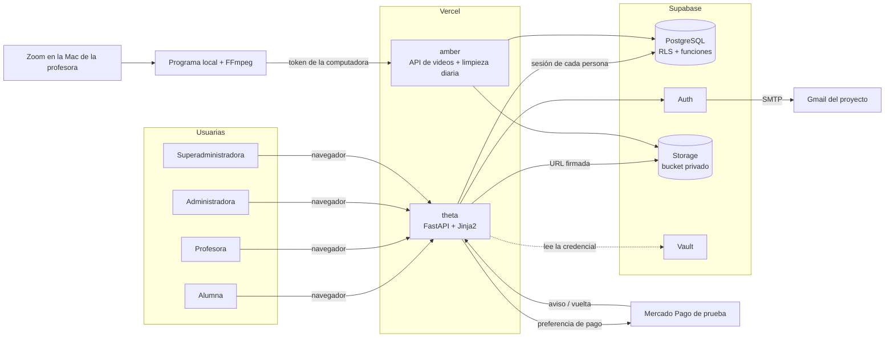
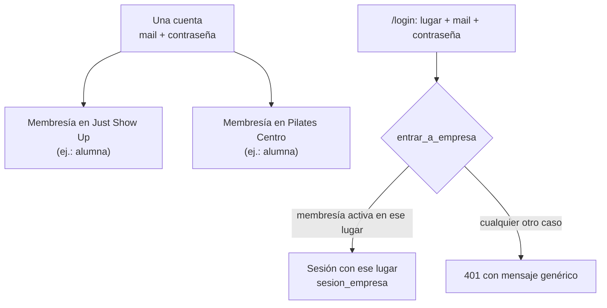
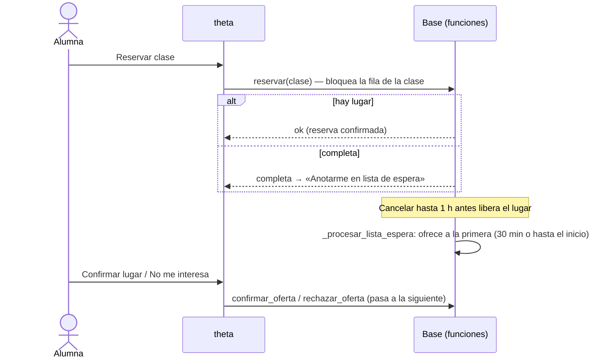
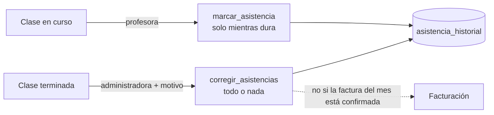
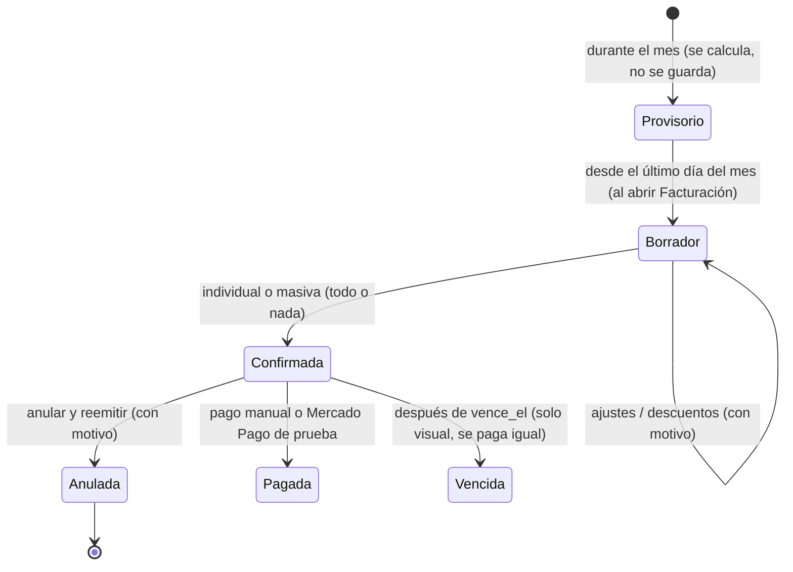
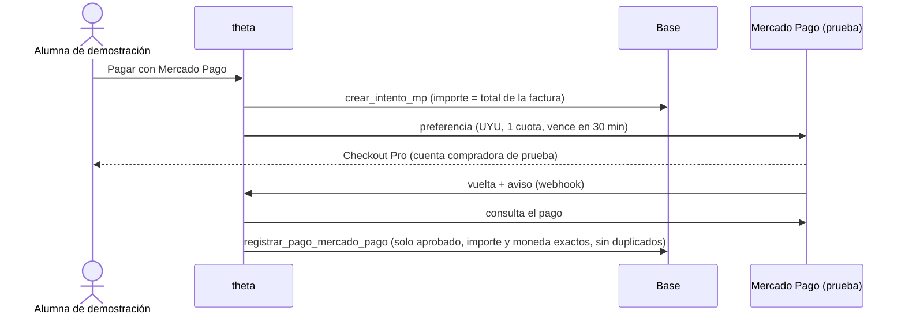
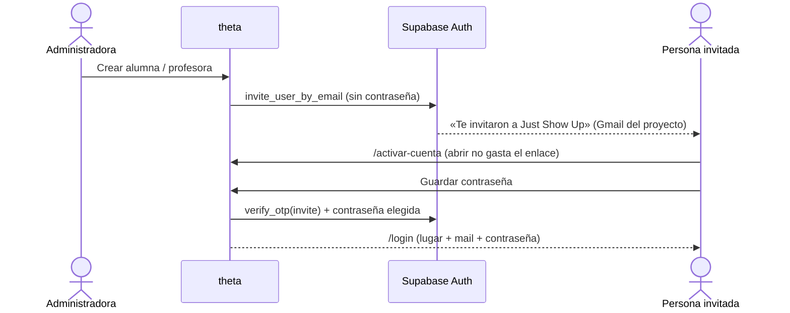
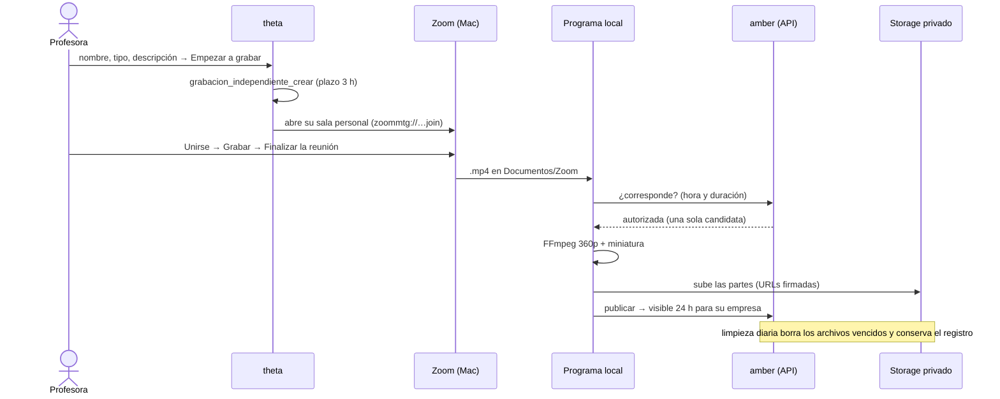

# Arquitectura de Just Show Up

> Estado al **10/11/2026** (`main` = `3f765ee`, desplegado en theta). Complementa `docs/MER.md`. Detalle de cada regla
> y sus pruebas en `CLAUDE.md`; estado y pendientes en `CONTINUIDAD_PROYECTO.md`.

## 1. Tecnologías (todo en planes gratuitos, costo $0)

| Pieza | Tecnología | Para qué |
|---|---|---|
| Servidor y pantallas | **Python 3.12 + FastAPI + Jinja2** (HTML generado en el servidor, sin framework JS) | Rutas, permisos, formularios |
| Base de datos y cuentas | **Supabase Free**: PostgreSQL 17, Auth, Storage, Vault | Datos, RLS, funciones, sesiones, archivos privados, secretos |
| Hosting | **Vercel Hobby**: *theta* (sitio oficial, se despliega solo con cada merge a `main`) y *amber* (recibe las subidas de videos y corre la limpieza diaria) | |
| Correos | **Gmail SMTP** de una cuenta exclusiva del proyecto, configurado en Supabase Auth | Invitaciones y «Olvidé mi contraseña» |
| Pagos | **Mercado Pago Checkout Pro, solo modo de prueba** (cuentas ficticias) | Demostración de cobro |
| Videos | **Zoom Básico** (grabación en la computadora) + **programa local en Python + FFmpeg** | Grabar, comprimir, subir |
| PDF | `fpdf2` | Facturas |
| Pruebas | `unittest`, Postgres local (`pgserver`), Supabase local (Colima + CLI), Mailpit | Sin tocar producción |

## 2. Vista general

- La app habla con Supabase **con la sesión de cada persona** (`_sb(usuario)`), así las políticas RLS se aplican a quien
  pide. La clave de servidor se usa solo para administrar cuentas (invitaciones, cerrar sesiones) y leer el Vault.
- Las cookies `sb_acceso` / `sb_refresco` son `httpOnly`, `SameSite=lax` y `secure`; el servidor valida y renueva el
  token en cada pedido.

## 3. Multiempresa

- Cada fila de negocio lleva `id_empresa`; las políticas filtran por la **empresa de la sesión** (`empresa_de_sesion()`).
- Una persona puede estar en varias empresas con roles distintos y la misma contraseña; cada dispositivo elige su lugar.
- Nunca se muestran listas de empresas ni se distingue «lugar inexistente» de «credenciales incorrectas».
- La superadministradora no pertenece a ninguna empresa: entra por `/admin/login`.

## 4. Roles y permisos

Cada membresía tiene **exactamente un rol**. La base vuelve a comprobar todo lo que filtra la pantalla.

| Acción | Alumna | Profesora | Administradora | Superadministradora |
|---|:-:|:-:|:-:|:-:|
| Reservar, cancelar, lista de espera | ✔ | | | |
| Mis inscripciones, Mi historial, Mis facturas | ✔ | | | |
| Pagar con Mercado Pago (solo la alumna de demostración) | ✔ | | | |
| Ver Videos On Demand de su empresa | ✔ | ✔ | ✔ | |
| Grabar («Empezar a grabar») | | ✔ | ✔ | |
| Horarios y clases | | solo los suyos | toda la empresa | |
| Marcar asistencia (durante la clase) | | sus clases | ✔ | |
| Corregir asistencias de clases terminadas (con motivo) | | | ✔ | |
| Planificación (licencias, cancelaciones puntuales) | | sus clases | ✔ | |
| Estadísticas | | sus clases | toda la empresa o por profesora | |
| Tipos de clase | | | ✔ | |
| Ver la lista de alumnas | | solo lectura | ✔ | |
| Alumnas y profesoras: invitar, editar, desactivar, cédula | | | ✔ | |
| Facturación, ajustes, confirmar, anular, pagos | | | ✔ | |
| Estado y errores de grabaciones | | | ✔ | |
| Empresas, administradoras, cobro del 25 % | | | | ✔ |

## 5. Reservas y lista de espera

- No hay tareas programadas: las ofertas vencidas se procesan al abrir la grilla, el día o Mis inscripciones.
- Las clases se generan solas (idempotente) al abrir una semana; respetan licencias, cancelaciones y tipos.

## 6. Asistencias

- Sin fila = «sin registrar» (distinto de ausente). Nada se marca ausente automáticamente.
- Inicio, Asistencias y la confirmación de facturas avisan las clases con asistencias pendientes.

## 7. Facturación y cobro del 25 %

- **Qué se cobra**: reservas confirmadas de clases dictadas del mes. Las canceladas (por la alumna a tiempo o por la
  profesora) no se cobran.
- **25 %**: una ausencia explícita se cobra el 25 % del precio de la clase; presente o sin registrar, el 100 %. Rige
  desde `empresa.cobro_inasistencia_desde` (Just Show Up 01/09/2026, Pilates Centro 01/10/2026).
- **Vencimiento**: día 10 del mes siguiente, o 10 días desde la confirmación si se confirma después.
- La alumna ve sus facturas confirmadas desde el día 1 del mes siguiente (lo aplica RLS). PDF con los datos guardados.
- Todo cambio queda en `factura_historial`; numeración `JSU-AAAA-MM-NNNN` por empresa.

## 8. Mercado Pago (solo modo de prueba)

- Credencial de prueba cifrada en el Vault; interruptor en la base. Solo `alumna@prueba.invalid` puede iniciar un pago.
- Guía de la demostración: `GUIA_DEFENSA_MERCADO_PAGO.md`.

## 9. Invitaciones y autenticación

- Ninguna pantalla genera ni muestra contraseñas. Una cuenta existente (otra empresa) solo suma la membresía.
- Cuentas pendientes: no pueden entrar; se reenvía o se anula la invitación. Enlaces de 1 h y un solo uso.
- «Olvidé mi contraseña» responde igual exista o no la cuenta; «Enviar correo para cambiar la contraseña» usa ese flujo.

## 10. Videos On Demand

- El programa no lleva claves de Supabase: URL, entorno y un token por computadora (en la base solo su huella).
- **Regla de los 15 minutos** (`_video_evaluar`, 10/11): una grabación se asocia a la solicitud de «Empezar a grabar»;
  una clase presencial solo compite si tiene grabación activada o ya tiene video. Sin solicitud ni clase candidata, no se
  sube nada.
- Reproducción con URLs firmadas de hasta 90 min; topes de almacenamiento y transferencia en `video_parametros`.

## 11. Seguridad

- **RLS en todas las tablas**; ninguna política ni permiso de escritura para `anon` (verificado el 10/11).
- **Escrituras solo por funciones** que validan rol, empresa, fechas y versión (`security definer`).
- **Rutas protegidas en el servidor** (`requiere_login/alumna/profesora/admin/superadmin`); sin sesión → `/login`.
- **Secretos** solo en `.env`, Vercel, Vault y el panel de Supabase; nunca en el repo.
- **Auditoría**: `factura_historial`, `asistencia_historial`, `baja_docente`, `pago_anulacion`, `mp_evento`.
- Pendientes conocidos: claves legacy de Supabase todavía activas en theta y amber; procedimiento en
  `docs/PROCEDIMIENTOS_DEFENSA.md`.
