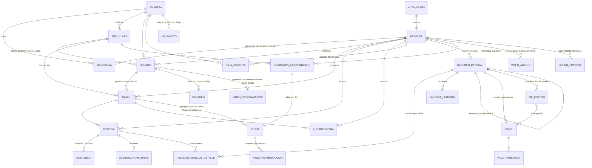

# Modelo entidad-relación (MER) — Just Show Up

> Generado el **10/11/2026** a partir del esquema real de producción (Supabase `nspgafucytcjqkqnmkry`, 30 migraciones
> aplicadas, iguales a `supabase/migrations/`). Solo estructura: no contiene datos.
> Reemplaza al borrador de la rama `documentacion-mer` (02/11), que no incluía bajas, correcciones de asistencia,
> cobro del 25 %, Videos On Demand ni invitaciones.

Convenciones: nombres en español y `snake_case` (como en la especificación). Toda tabla de negocio lleva
`id_empresa` (multiempresa) y tiene RLS activado. `auth.users` es la tabla de cuentas de Supabase Auth; `profiles`
es 1:1 con ella (la «Usuario» de la especificación).

## Diagrama general

Tablas sin relaciones: `mp_configuracion` (interruptor de Mercado Pago, solo la lee el servidor), `video_parametros`
(reglas y topes de Videos, una fila) y `_tres_roles_respaldo` (respaldo técnico de la migración de tres roles).

## Catálogo de tablas

### Multiempresa y personas
| Tabla | Para qué | Campos principales |
|---|---|---|
| `empresa` | Cada lugar (Just Show Up, Pilates Centro) | `nombre`, `codigo` (JSU, PIL), `activa`, `ultimo_numero_factura`, `mp_habilitado`, `cobro_inasistencia_desde` |
| `profiles` | Persona (1:1 con `auth.users`) | `nombre`, `apellido`, `mail`, `telefono`, `fecha_nacimiento`, `fecha_vencimiento_carne_salud`, `es_superadmin`, `empresa_activa` |
| `membresia` | Rol de una persona en una empresa | `id_usuario`, `id_empresa`, `es_admin` / `es_profesora` / `es_alumna` (exactamente uno), `activa`, `cedula` (por empresa) |
| `sesion_empresa` | Lugar elegido en cada sesión (cada dispositivo) | `session_id`, `id_usuario`, `id_empresa` |
| `baja_docente` | Registro de una desactivación de docente | `id_usuario`, `por`, `era_administradora`, `motivo`, `id_bloqueo`, horarios/clases/reservas afectados |

### Clases, reservas y lista de espera
| Tabla | Para qué | Campos principales |
|---|---|---|
| `tipo_clase` | Catálogo (Gimnasia, Pilates…) | `nombre`, `descripcion`, `imagen_url`, `duracion`, `precio_presencial`, `cupo_max`, `activo` |
| `horario` | Horario semanal recurrente | `dia_semana`, `hora_inicio`, `id_tipo_clase`, `id_profesora`, `activo` (duración, cupo y precio salen del tipo) |
| `clase` | Una fecha concreta de un horario | `fecha`, `hora_inicio`, `estado` (programada/cancelada/finalizada), foto de `precio`, `duracion`, `cupo_max`, `id_tipo_clase` |
| `reserva` | Lugar reservado por una alumna | `id_alumna`, `id_clase`, `estado` (confirmada/cancelada), `fecha_cancelacion`, `id_bloqueo` (canceló la profesora) |
| `listadeespera` | Turno cuando la clase está completa | `posicion`, `estado` (en_espera/ofrecido/confirmado/expirado/retirado), `oferta_vence_en` (30 min) |
| `bloqueo` | Licencias, cancelaciones puntuales y bajas | `tipo`, `fecha_desde`, `fecha_hasta`, `id_horario`, `motivo` (privado) |

### Asistencias
| Tabla | Para qué | Campos principales |
|---|---|---|
| `asistencia` | Una fila por reserva (sin fila = sin registrar) | `id_reserva` (único), `estado` (presente/ausente) |
| `asistencia_historial` | Todo cambio (en clase o corrección) | `estado_anterior`, `estado_nuevo`, `origen` (clase/correccion), `motivo`, `por` |

### Facturación y pagos
| Tabla | Para qué | Campos principales |
|---|---|---|
| `resumen_mensual` | Factura mensual de una alumna | `mes`, `anio`, `estado_factura` (borrador/confirmada/anulada), `estado_pago` (pendiente/pagado/sin_cargo), `total`, `version`, `numero`, `vence_el`, `reemplaza_a`, copia de nombre y cédula al confirmar |
| `resumen_mensual_detalle` | Una línea por clase cobrada | `fecha`, `tipo_nombre`, `precio_original`, `porcentaje` (25/100), `asistencia`, `ajuste_tipo`, `importe_final` |
| `factura_historial` | Auditoría de la factura | `accion`, `detalle`, `motivo` (interno), `por`, `en` |
| `pago` | Pago registrado | `monto`, `medio_pago` (efectivo/transferencia/mercado_pago), `fecha`, `estado` (vigente/anulado), `id_transaccion` |
| `pago_anulacion` | Por qué se anuló un pago | `motivo`, `anulado_por`, `anulado_en` |

### Mercado Pago (solo modo de prueba)
| Tabla | Para qué | Campos principales |
|---|---|---|
| `mp_configuracion` | Interruptor general | `habilitado`, `modo` |
| `mp_intento` | Un intento de pago Checkout Pro | `id_resumen_mensual`, `monto`, `preference_id`, `estado`, `id_pago_mp`, `id_pago` |
| `mp_evento` | Avisos (webhook) recibidos | `origen`, `tipo`, `id_recurso`, `resultado` |

La credencial de prueba está cifrada en **Supabase Vault** (no es una tabla de `public`).

### Videos On Demand
| Tabla | Para qué | Campos principales |
|---|---|---|
| `grabacion_independiente` | Clase registrada con «Empezar a grabar» | `titulo`, `id_tipo_clase`, `descripcion`, `vence_espera_en` (3 h), `inicio_grabacion`, `cancelada_en` |
| `video` | Video publicado o en proceso | `estado`, `huella_sha256`, `duracion_seg`, `tamano_bytes`, `partes`, `lista_hls`, `publicado_en`, `vence_en` (24 h), `miniatura`, `id_grabacion` / `id_clase` |
| `video_reproduccion` | Cuánto vio cada persona (topes de consumo) | `segundos_vistos`, `bytes_estimados` |
| `video_agente` | Computadora autorizada a subir | `id_profesora`, `nombre`, `token_hash` (solo la huella), `activo` |
| `video_programacion` | Horarios con grabación activada (se retiró de la pantalla el 09/11; hoy ninguno activo) | `id_horario`, `activa`, `activa_desde` |
| `video_parametros` | Reglas y topes | ventanas, duraciones mínimas/máximas, `almacenamiento_max_bytes`, `tope_ciclo_bytes`, `entorno` |

## Reglas que sostiene la base (no la pantalla)

- **Un rol por empresa** (`membresia_un_solo_rol`) y nunca una empresa sin administradora activa.
- **Sin sobreventa**: `reservar` bloquea la fila de la clase; índices únicos impiden reserva activa duplicada y estar dos
  veces en la misma lista de espera.
- **Una asistencia por reserva** (`asistencia.id_reserva` único); solo se escribe con `marcar_asistencia` /
  `corregir_asistencias`.
- **Una factura no anulada por alumna, empresa y mes**; un solo pago vigente por factura; el número de una operación de
  Mercado Pago nunca se registra dos veces.
- **Una grabación esperando por profesora**; un video por clase o por grabación.
- **Nadie escribe directo en las tablas**: las escrituras pasan por funciones `security definer` que validan sesión, rol,
  empresa y fechas (por eso el analizador de Supabase las lista como «ejecutables por usuarias con sesión»).
- `reserva.id_bloqueo` **no tiene clave foránea a propósito** (conserva quién canceló aunque se borre el bloqueo).
